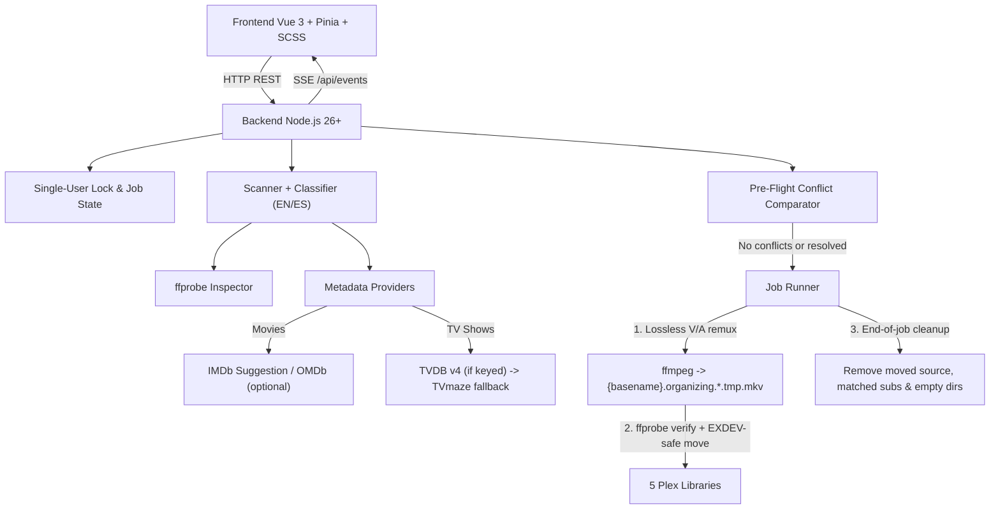

# Plex Video Organizer for NAS (Docker)

- **Author:** Franco Gastón Pellegrini
- **Status:** Proposed
- **Date:** 2026-11-12

---

## Overview

Dockerized NAS web application (with ports, mount paths, and optional API keys configured via `.env`), built with **Vue 3 + Vite+ (`vp`) + SCSS** on the frontend and **Node.js 26+** on the backend, governed by `@francogp/auditor` (`v10.11.2`).

The system replaces the legacy desktop tools in `O:\ACOMODAR\` (`file-renamer-for-plex` in Java/OMDb and the `mkvpropedit` `.bat` scripts) with a local-network (LAN) web console. It identifies movies (`{imdb-tt...}`) and TV shows (`{tvdb-...}`), lets the user adjust audio and subtitle tracks, validates destination conflicts before writing, and losslessly remuxes video and audio to `.mkv` using `ffmpeg`.

## The Problem

The current workflow relies on Windows scripts coupled to local paths and disconnected manual steps:

1. `file-renamer-for-plex` only handles existing `.mkv` files, fails if year or resolution is missing from the folder name, leaves `.srt` files external, and lacks TV show or multi-library support.
2. The `edit-audio-to-*.bat` scripts invoke `mkvpropedit` unconditionally on `v1`/`a1` without inspecting multiple audio tracks or updating the `default` flag.
3. There is no pre-flight collision check or single-user processing lock on the LAN, risking accidental overwrites or partial files in Plex libraries.

This application unifies scanning, metadata identification, track editing, pre-flight conflict resolution, lossless video/audio `.mkv` remuxing with embedded subtitles in the source directory, atomic/`EXDEV`-safe moves into 5 Plex libraries, and processed-item leftover cleanup inside a single Docker service.

## Goals

- **Environment and Persistent Settings:** Configure ports, `PUID`/`PGID` (`user: "${PUID}:${PGID}"` in Compose), Docker volume mounts (`/data/input`, `/data/output/*`, `/config`), and optional keys (`OMDB_API_KEY`, `TVDB_API_KEY`) in `.env` as the single source of truth (validated at startup; read-only in the UI).
- **Plex Detection and Identification:** Conform strictly to the official Plex standards in `docs/plex/` (movies, TV shows, editions, multi-version, exclusions, `.plexmatch`/`.plexignore`, and local assets). Distinguish movies vs. TV shows in nested folders (English/Spanish) and loose root files; query IMDb/OMDb for movies (`{imdb-tt...}`) and TVDB v4 (when keyed) or TVmaze public API (when unkeyed, reading `externals.thetvdb`) for TV shows (`{tvdb-...}`), presenting multiple candidates and manual ID entry in the UI.
- **Lossless Video/Audio MKV Remux and Track Control via `ffmpeg`:** Inspect streams with `ffprobe`, allow tagging audio languages (ISO-639-2 with `spa`/`eng`/`jpn`/`und` presets), selecting the `default` audio track, and embedding directory subtitles inside `.mkv` (`-c:v copy -c:a copy`, converting only incompatible text subtitles like `mov_text` to `srt`, preserving `forced` disposition).
- **Blocking Pre-Flight Conflict Resolution:** Compare file size, container/format, bitrate, resolution, subtitles, and audio languages between existing and incoming files (plus intra-batch collisions and free disk space) before starting a job, requiring an explicit `overwrite` or `ignore` choice per conflict.
- **Atomic File Moves and Single-User LAN Lock:** Hold an in-memory single-user lock across active queue/processing states while streaming live progress to other LAN viewers; remux to a unique temporary file in the input directory, verify with `ffprobe`, move safely (`EXDEV`-safe) with pre-move TOCTOU re-check, and clean up moved-item leftovers at job completion.
- **Documentation and Quality Gates:** Maintain official Plex standards under `docs/plex/` and keep `0` errors/warnings in `@francogp/auditor` alongside 85%+ unit/integration test coverage in `tests/`.

## Non-Goals

- Lossy video or audio transcoding.
- Using `mkvpropedit` or `MKVToolNix`.
- Requiring a TVDB API key (when absent, TVmaze is used as a fallback).
- Multi-user authentication, role management, or public Internet exposure outside the LAN.

## Critical User Journeys (CUJs)

### CUJ 1: Mixed-Batch Scan, Classification, and Identification

- **Given:** The input directory and 5 output directories are configured and the queue state is `IDLE`.
- **When:** The user clicks **Scan** in the main view.
- **Then:** The backend walks the input directory respecting nested folder rules (`season`/`temporada`, `SxxExx`/anchored `NxNN` patterns, ignoring `Subs`/`Extras`), queries metadata providers, and displays each item with candidates, editable media kind, and target output category.

### CUJ 2: Per-File and Batch Track Configuration

- **Given:** A scanned video has multiple audio tracks or external subtitles in its directory.
- **When:** The user opens the track inspector (or applies settings in batch across a series), sets audio languages (`spa`/`eng`/`jpn`/`und` or other ISO-639-2), picks the `default` audio track, and resolves any ambiguous subtitle merge/order.
- **Then:** The track configuration is persisted for single-pass `ffmpeg` (`-c:v copy -c:a copy`) remuxing into `.mkv`.

### CUJ 3: Pre-Flight Conflict Resolution and Single-User Processing

- **Given:** One or more mapped outputs collide with existing files or intra-batch paths.
- **When:** The user clicks **Process**.
- **Then:** Execution is blocked until the user reviews the side-by-side technical comparison and selects `overwrite` or `ignore` for every conflict. Upon confirmation, the server remuxes each included item to `{basename}.organizing.<jobId>.<itemId>.tmp.mkv` in the source folder, verifies with `ffprobe`, moves to the target library, and deletes processed source files, matched sidecars, and item-folder images/NFOs once all moves succeed.

## Technical Plan (Architecture)

### 1. Docker Topology and Environment Variables

The system runs as a single Docker container (`node:26-slim` with `ffmpeg`) serving both the built frontend (`dist/`, with assets in `dist/assets/` matching `bundle.distDir` in `.auditor/audit.config.ts`) and the Node.js 26+ native TypeScript REST + SSE backend (`src/server/index.ts`, using `.ts` relative import specifiers and no `enum`/parameter properties).

- **`.env` & Permissions:** Defines `APP_PORT`, `DEV_CLIENT_PORT`, `PUID` / `PGID` (applied natively via `user: "${PUID}:${PGID}"` in `docker-compose.yml`), host mount paths (`HOST_CONFIG_PATH`, `HOST_INPUT_PATH`, `HOST_OUTPUT_MOVIES_PATH`, `HOST_OUTPUT_DOCUMENTARIES_PATH`, `HOST_OUTPUT_ANIMATED_MOVIES_PATH`, `HOST_OUTPUT_TV_SHOWS_PATH`, `HOST_OUTPUT_ANIMATED_SERIES_PATH`), and optional API keys (`OMDB_API_KEY`, `TVDB_API_KEY`). Container mount roots (`/data/input` and `/data/output/*`) are validated on startup and treated as the single source of truth.
- **Persistence:** Active queue items and `revision` persist to `/config/queue.json` for crash inspection, while the single-user LAN lock (`lockOwnerClientId`) is strictly ephemeral in memory so container restarts release any stale lock automatically.

### 2. Backend Architecture (`src/domain/` and `src/server/`)

- **Pure Domain Layer (`src/domain/`):**
  - Literal union types derived from `as const` tuples in `constants.ts` with `valibot` schema parity and branded IDs (`JobId`, `ItemId`, `ImdbId`, `TvdbId`, `TmdbId`, `ClientId`) satisfying `@francogp/domain-type` rules: `MediaKind = 'movie' | 'tv'`, `OutputCategory = 'movies' | 'documentaries' | 'animated-movies' | 'tv-shows' | 'animated-series'`, `JobPhase = 'IDLE' | 'SCANNING' | 'READY' | 'PREFLIGHT_BLOCKED' | 'PROCESSING' | 'ERROR'`, `ConflictDecision = 'overwrite' | 'ignore'`, `SubtitleMergeMode = 'keep-and-add' | 'replace' | 'selected-only'`, and `Iso639_2Code` with quick presets `'spa' | 'eng' | 'jpn' | 'und'`. `MediaKind` independently governs the Plex naming template (`movie` vs `tv`) regardless of `OutputCategory` (allowing `'documentaries'` to hold either).
  - Tag extractors and Plex standards (aligned with `docs/plex/` and modernized from `MovieFolder.java`): resolution (`480p|720p|1080p|1440p->2k|2160p->4k|4320p->8k`), optional Plex `{edition-<Name>}` (max 32 characters; applied to Movie folder+filename or TV Show root folder only—never season/episode—per `docs/plex/multiple-editions*.md`) vs. ignored scanner bracket tags `[res, Extended, Directors Cut, Unrated, Spanish Audio, HDR, 10bit]`, split-part suffixes (`- cdX`, `- discX`, `- diskX`, `- dvdX`, `- partX`, `- ptX`, up to 8 parts), and filename sanitization (`&` -> `and`, stripping `[\\/:*?"<>|]`).
  - Plex path formatters:
    - Movie: `{Title} ({Year}) {imdb-ttXXXXXXX}[ {edition-...}][ [tags]]/{Title} ({Year}) {imdb-ttXXXXXXX}[ {edition-...}][ [tags]][ - ptX].mkv` (supporting `{tmdb-XXXXXX}` when provided via `.plexmatch`/input, multi-version tags in `[...]` per `docs/plex/multi-version-movies.md`, and preserving split-part suffixes so `pt1`/`pt2` do not falsely collide).
    - TV Show: `{Show} ({Year}) {tvdb-<ID>}[ {edition-...}]/Season {XX}/{Show} ({Year}) - s{XX}e{XX} - {Episode}[ - ptX].mkv` (always including `(Year)` when available; normalizing `Season 01` for miniseries and `Season 00` / `s00eXX` for `Season 00`/`Specials`; supporting multi-episode `s01e01-e02`, split-part suffixes, and date-based `YYYY-MM-DD` / `DD-MM-YYYY` with `-`, `.`, or space separators; omitting `{tvdb-...}` with a UI warning if TVmaze returns `null`). All generated paths are validated with `path.resolve` containment inside the target library root.
- **Scanner and Classifier (`src/server/services/scanner.ts`):**
  - Walks `inputDir` using Node.js 26 native `fs.readdir(inputDir, { recursive: true, withFileTypes: true })` (no custom recursive directory walker, satisfying `no-homebrew-file-walker`) while enforcing official Plex exclusions (`docs/plex/special-keyword-file-folder-exclusion.md`, `local-files-for-tv-show-trailers-and-extras.md`, and `local-media-assets-tv-shows.md`): ignores `sample` files strictly `< 300 MB` (keeping `>= 300 MB`), folders containing `extras`, `samples`, `bonus`, `bonus disc`, `subs`, `subtitles`, or extra subfolders (`Behind The Scenes`, `Deleted Scenes`, `Featurettes`, `Interviews`, `Scenes`, `Shorts`, `Trailers`, `Other`) at show or season depth, inline extra suffixes with optional trailing index (`-(behindthescenes|deleted|featurette|interview|scene|short|trailer|other)\d*`), non-video local assets (`theme.mp3`, `.jpg`/`.jpeg`/`.png`/`.tbn` artwork), unsupported disk images (`.dvdmedia`, `.iso`, `.img`, `VIDEO_TS/`, `BDMV/`), `.plexignore` glob rules (root-recursive vs. local `/` rules), and leftover `*.organizing.*.tmp.mkv` files (pruned at startup when no job is active).
  - Parses `.plexmatch` files (`docs/plex/plexmatch.md`) in show or season folders (series-level hints cascade to subfolders; season-level hints scope locally), honoring `title`/`show`, `year`, `season`, `tvdbid`, `tmdbid`, `imdbid` (with or without `tt` prefix), `guid`, `pattern`/`pt` tokens (`{s|se|season}`, `{e|ep|episode}`, `{sp|special}`, `{see}`), and `ep`/`episode` (`SPxx`, `Exx`, `SxxExx`, and relative subpaths) overrides.
  - Classifies as **TV Series** when the deepest meaningful folder contains `season`, `temporada`, or `specials` (EN/ES) or the filename matches episode patterns (`SxxExx`, date-based `YYYY-MM-DD`/`DD-MM-YYYY` with `-`/`.`/space, or boundary-anchored `NxNN` excluding dimensions like `4x4`), including loose root files; otherwise classifies as **Movie**. Users can override `MediaKind`, `OutputCategory`, `edition`, and `include` (whether to convert) in the UI.
  - Pairs external subtitles in the video directory and any immediate `subs/` or `subtitles/` subfolder (case-insensitive, per `docs/plex/adding-local-subtitles-to-your-media.md`), supporting `.srt`, `.smi`, `.ssa`, `.ass`, `.vtt`, and `.idx+.sub`, normalizing ISO-639-1 (2-letter), regional tags (`es-419`, `pt-BR`, `en-US`), and ISO-639-2/B codes (`ger`, `fre`, `spa`, `eng`, `jpn`) plus `.forced`/`.sdh`/`.cc` flags, sniffing `.sub` headers to distinguish binary VobSub from text MicroDVD, and warning if a binary `.sub` lacks its `.idx` pair.
- **Metadata Providers (`src/server/services/metadata/`):**
  - **Movies:** Queries public IMDb suggestions (`v3.sg.media-imdb.com/suggestion/...`) without a key and optionally enriches/falls back via OMDb when `OMDB_API_KEY` is set; supports manual `imdbId` entry in the UI.
  - **TV Shows:** Uses TVDB v4 (`POST /v4/login` + `/v4/search` + episodes with selectable `aired`/`dvd`/`absolute` episode ordering per `docs/plex/naming-and-organizing-your-tv-show-files.md`) when `TVDB_API_KEY` is set in `.env`; otherwise uses public TVmaze (`api.tvmaze.com/search/shows` + `/shows/{id}/episodes`) with session caching and rate-limiting (<= 20 req / 10 s) solely to resolve `externals.thetvdb` and episode titles; supports manual `tvdbId` entry in the UI.
- **FFprobe & FFmpeg Media Wrapper (`src/server/services/media/`):**
  - Uses `node:child_process.spawn` with argument arrays exclusively (no shell interpolation).
  - `ffprobe` extracts file size, container format, total bitrate, duration, and video/audio/subtitle streams.
  - **Automatic-First Subtitle & Index Resolution:** Automatically infers external subtitle languages from filename suffixes and defaults to `keep-and-add` (preserving internal `0:s?` streams and appending external subtitles at deterministic indices `0..N-1`). The UI prompts the user interactively **only when automatic resolution is ambiguous** (e.g., unknown/untagged subtitle language, duplicate language collision, or unclear internal+external merge preference), offering explicit options (`keep-and-add`, `replace`, or `selected-only` + stream order).
  - `ffmpeg` executes a lossless video copy pass (`-c:v copy`) into `{basename}.organizing.<jobId>.<itemId>.tmp.mkv`, streaming real-time progress and ETA via `-progress pipe:1`:
    - Video & audio: `-c:v copy`, default `-c:a copy` (with optional Peak Gain or parallel-analyzed 2-pass EBU R128 `loudnorm` audio normalization), `-map 0:V:0` (uppercase `V` excluding `attached_pic` thumbnails), mapped audio tracks with `-metadata:s:a:i language=...`, and `-disposition:a 0` before `-disposition:a:k default`.
    - Subtitles: uses `.idx` for VobSub pairs, pre-normalizes non-UTF-8 text subtitles (`.srt`, `.vtt`, `.ass`, `.ssa`, `.smi` in `Windows-1252`/UTF-16) to UTF-8, sets per-stream `-c:s:<outIdx> copy` (or `srt` only on incompatible text codecs like `mov_text`), sets `-metadata:s:s:j language=...`, and preserves `-disposition:s:j forced` (`.forced`) and `-disposition:s:j hearing_impaired` (`.sdh`/`.cc`).
- **Pre-Flight Conflict Gate (`src/server/services/preflight.ts`):**
  - Checks intra-batch destination collisions, target mount free disk space (`fs.statfs`), and existing files in output directories prior to job start. For each collision, runs `ffprobe` on the existing destination file and returns a side-by-side comparison (file size, format, bitrate, resolution, audio languages, subtitles) against the projected output, blocking job start until every conflict has an explicit `overwrite` or `ignore` decision.
- **Single-User LAN Lock and Job Runner (`src/server/services/jobRunner.ts`):**
  - Client identity: each browser tab generates a persistent `browserId` + `tabId` via a `try/catch`-wrapped typed storage helper (`src/client/utils/storage.ts`, avoiding raw `localStorage`/`sessionStorage` calls per `oxlint` rules), sent as `X-Client-Id: <browserId>:<tabId>` on every mutating request (survives tab refresh, distinguishes tabs and LAN devices without login).
  - Server-owned state machine (`IDLE` -> `SCANNING` -> `READY` -> `PREFLIGHT_BLOCKED` -> `PROCESSING` -> `IDLE`/`ERROR`) with queue `revision` and `items` persisted to `/config/queue.json`, while `lockOwnerClientId` remains strictly in memory.
  - `lockOwnerClientId` is acquired on `POST /api/scan` and held across `SCANNING`, `READY`, `PREFLIGHT_BLOCKED`, and `PROCESSING` until job completion or explicit unlock; mutating requests from other `X-Client-Id`s or with stale `revision` are rejected with HTTP `409 Conflict` (`LOCK_HELD` or `STALE_REVISION`). Non-owners can recover via `POST /api/jobs/unlock` only with `{ force: true }` (after explicit UI confirmation), which kills any active `ffmpeg` child, deletes `*.organizing.*.tmp.mkv`, and resets state from `ERROR`/`PROCESSING` to `IDLE`.
  - Post-remux verification & `EXDEV`-safe move: verifies `{basename}.organizing.<jobId>.<itemId>.tmp.mkv` integrity with `ffprobe`; re-checks destination non-existence immediately before moving when `decision !== 'overwrite'` (TOCTOU guard); attempts `fs.rename()`, and on `EXDEV` across Docker mounts, stream-copies to `.tmp` in destination, verifies byte size, atomically renames, and unlinks `{basename}.organizing.<jobId>.<itemId>.tmp.mkv` (cleaning orphaned `*.organizing.*.tmp.mkv` files on startup/failure).
  - **Deferred End-of-Job Cleanup:** Cleanup runs once after all file moves succeed, deleting source files, matched sidecars (including `.idx` + `.sub`), and item-folder images/NFOs for moved items, and removing directories only when empty (preserving directories with conflict-ignored or unselected items, and never deleting `inputDir`).

### 3. HTTP / SSE Contracts

| Endpoint               | Method  | Request / Response Contract                                                                                                                                                        |
| :--------------------- | :------ | :--------------------------------------------------------------------------------------------------------------------------------------------------------------------------------- |
| `/api/state`           | `GET`   | Returns `200` `{ phase, revision, lockOwnerClientId, mountPaths, items, activeJob }`                                                                                               |
| `/api/events`          | `GET`   | SSE stream emitting `event: state` (same shape as `/api/state`), `event: progress` (`{ jobId, itemId, percent, etaSeconds }`), and `event: log` (`{ level, message, timestamp }`)  |
| `/api/scan`            | `POST`  | Requires `X-Client-Id`; acquires lock, returns `202 Accepted` `{ revision }`, and streams scan/`ffprobe`/metadata via SSE                                                          |
| `/api/queue/items/:id` | `PATCH` | Requires `X-Client-Id` + body `{ revision, patch }` (`mediaKind`, `category`, `edition`, `candidateId`/`manualId`, `include`, `tracks`, `subtitles`); `409` on lock/stale revision |
| `/api/metadata/search` | `POST`  | Requires `X-Client-Id` + body `{ query, year?, kind, imdbId?, tvdbId?, episodeOrder? }`; returns `{ candidates }`                                                                  |
| `/api/preflight`       | `POST`  | Requires `X-Client-Id` + body `{ revision }`; returns `200` `{ revision, ok, diskSpace, conflicts: ConflictComparison[] }`                                                         |
| `/api/jobs/start`      | `POST`  | Requires `X-Client-Id` + body `{ revision, conflictResolutions: Record<ItemId, ConflictDecision> }`; starts sequential processing and returns `202` `{ jobId, revision }`          |
| `/api/jobs/unlock`     | `POST`  | Requires `X-Client-Id` (or body `{ force: true }` override); kills active `ffmpeg`, deletes `*.organizing.*.tmp.mkv`, and resets to `IDLE`                                         |

### 4. Frontend (`src/client/`)

- **Vue 3 (`<script setup lang="ts">`) + Pinia + SCSS** adhering to `styles.enforceScss` (max 3 nesting levels), `accessibility.enabled` (`id` + `<label for>` on all form controls), and `@francogp/auditor/modals` for stackable modals.
- **Visual System, Dark/Light Mode, and UI Skills:**
  - Dense dashboard guided by `ui-craft-dense-dashboard` (tabular numbers for sizes, bitrates, and progress), `frontend-design`, `design-taste-frontend`, `awesome-design-md`, and `web-design-guidelines`.
  - **Dark & Light Mode:** Semantic SCSS tokens (`oklch`/`color-mix` per `scss-best-practices`), `prefers-color-scheme` default, and persistent manual toggle via `src/client/utils/storage.ts` (`try/catch`-wrapped storage helper).
  - **GSAP Animations:** Queue transitions, modal/panel entrances, and progress indicators animated with GSAP (`gsap-core`, `gsap-frameworks`, `gsap-timeline`, `gsap-performance`, `design-motion-principles`), using `gsap.context()` cleaned up on `onUnmounted`, `gsap.matchMedia()` for `prefers-reduced-motion`, and zero CSS transitions or `transform !important` on GSAP-animated nodes (verified with `auditor:motion`).
- **Main View:** **Scan** button, dense queue table grouped by movie/series, output category selector (1 of 5), IMDb/TVDB candidate picker, track editor button (with series batch apply), and **Process** button. Displays a read-only lock banner and live SSE progress when another LAN user is running a job.

## Alternatives Considered

### Alternative A: Mandatory TVDB v4 API Key for TV Shows

- **Pros:** Direct official TheTVDB queries for 100% of searches without relying on an external bridge.
- **Cons:** Requires registering and configuring a v4 API key before TV show organization can work.
- **Reason for Rejection:** The app must operate even without a TVDB API key. When `TVDB_API_KEY` is present in `.env`, TVDB v4 is used directly; when absent, TVmaze's public API is used solely as a keyless bridge to extract `externals.thetvdb` and episode titles, always producing standard Plex `{tvdb-<ID>}` folders.

### Alternative B: Using `mkvpropedit` Alongside `ffmpeg`

- **Pros:** Near-instant header edits for language/default flags on files that are already `.mkv`.
- **Cons:** Requires bundling `MKVToolNix` in Docker and cannot remux `.mp4`/`.avi` or embed external subtitles in the same tool.
- **Reason for Rejection:** All inspection and remuxing is unified in `ffmpeg`/`ffprobe` (`-c:v copy -c:a copy`), handling container conversion, audio language tags, `default` disposition, and subtitle embedding in one single pass.

### Alternative C: Interactive Conflict Resolution Mid-Queue

- **Pros:** Non-conflicting files start processing immediately.
- **Cons:** Halts large batch runs mid-way waiting for user input while holding the global LAN lock indefinitely.
- **Reason for Rejection:** A blocking pre-flight gate checks all destination paths upfront and requires `overwrite` or `ignore` decisions before starting execution.

### Alternative D: Remuxing Directly Into the Plex Output Directory

- **Pros:** Skips the post-remux move step on single-volume setups.
- **Cons:** Exposes partial `.mkv` files to Plex library scanners and complicates recovery if the container stops mid-remux.
- **Reason for Rejection:** Remuxing writes to `.organizing.<jobId>.<itemId>.tmp.mkv` in the input directory, verifies integrity with `ffprobe`, and moves safely (`EXDEV`-safe) to the output directory before end-of-job cleanup.

## Non-Functional Requirements

- **Subprocess Security:** All `ffmpeg`/`ffprobe` invocations use `spawn(bin, args)` with argument arrays and no shell, preventing command injection from special characters in filenames.
- **NAS Storage Integrity and Permissions:** Supports `PUID`/`PGID` via Docker Compose `user:` and deferred cleanup that removes moved-item leftovers without deleting `inputDir`, conflict-ignored items, or unselected items.
- **LAN Observability:** SSE `/api/events` broadcasts lock ownership, percentage progress, and errors in real time to all connected browsers.

## Detailed Implementation Plan

### Target Files to Create/Modify

#### 1. Infrastructure, Docker, and Root Config

- **`.env.example`** _(Create)_: Documented template for `APP_PORT`, `DEV_CLIENT_PORT`, `PUID`, `PGID`, `HOST_CONFIG_PATH`, `HOST_INPUT_PATH`, `HOST_OUTPUT_MOVIES_PATH`, `HOST_OUTPUT_DOCUMENTARIES_PATH`, `HOST_OUTPUT_ANIMATED_MOVIES_PATH`, `HOST_OUTPUT_TV_SHOWS_PATH`, `HOST_OUTPUT_ANIMATED_SERIES_PATH`, `OMDB_API_KEY` (optional), and `TVDB_API_KEY` (optional).
- **`Dockerfile`** _(Create)_: Multi-stage image on `node:26-slim` + `ffmpeg`, building the frontend (`vp build` -> `dist/`) and running `node src/server/index.ts` with configurable `PUID`/`PGID` and `HEALTHCHECK` on `/api/state`.
- **`docker-compose.yml`** _(Create)_: Single NAS service reading ports, `PUID`/`PGID`, keys, and volume paths from `.env`.
- **`package.json`** _(Modify)_: Add runtime dependencies (`vue`, `pinia`, `gsap`, `valibot`, `@vueuse/core`) and devDependencies (`@vitejs/plugin-vue`, `sass`, `vue-tsc`, `@vue/test-utils`, `happy-dom`); update `"build": "npm run auditor:full && vp build && npm run auditor:post-build"` and add `"dev:server": "node --watch --env-file=.env src/server/index.ts"`, `"dev:client": "vp dev"`, and `"start": "node --env-file-if-exists=.env src/server/index.ts"`.
- **`vite.plugins.ts`** _(Create)_ & **`vite.config.ts`** _(Synced via `npm run auditor:fix`)_: Export `vue()` and `vitePrecompressPlugin()` from `@francogp/auditor`, bind `server.port` to `DEV_CLIENT_PORT` (`5173`), and proxy `/api` (including SSE) to `http://127.0.0.1:${APP_PORT}` (`3000`).

#### 2. Pure Domain Layer (`src/domain/`)

- **`src/domain/types.ts`** _(Create)_: Literal union types (`MediaKind`, `OutputCategory`, `JobPhase`, `ConflictDecision`, `SubtitleMergeMode`, `Iso639_2Code`) derived from `as const` tuples in `constants.ts` with `valibot` schema parity, branded IDs (`JobId`, `ItemId`, `ImdbId`, `TvdbId`, `TmdbId`, `ClientId`), and contracts (`MediaProbeSummary`, `ScannedItem`, `TrackSelection`, `ConflictComparison`).
- **`src/domain/constants.ts`** _(Create)_: Typed `as const` constants (video/subtitle extensions including `.vtt`/`.smi`, ignored auxiliary/extra folders, ISO-639-1/2 language normalization tables, TVmaze rate limits, quality/episode/date/split-part regex patterns).
- **`src/domain/plexFormatter.ts`** _(Create)_: Pure functions to extract resolution/edition/HDR/10bit/Spanish Audio tags (modernizing `MovieFolder.java`), sanitize filenames, and build Plex paths for movies and TV shows.
- **`src/domain/AGENTS.md`** _(Create)_: DOX index for domain layer.

#### 3. Node.js 26+ Backend (`src/server/`)

- **`src/server/config.ts`** _(Create)_: `valibot` validation of `.env` variables (defaulting `APP_PORT=3000`, `DEV_CLIENT_PORT=5173`, `PUID=1000`, `PGID=1000`) and container mount paths (`/data/input` + 5 `/data/output/*` roots) as the single source of truth.
- **`src/server/services/scanner.ts`** _(Create)_: Native `fs.readdir(..., { recursive: true, withFileTypes: true })` walker enforcing `docs/plex/` exclusions (`sample < 300 MB`, extras/bonus/disk-image folders, `.plexignore`), `.plexmatch` hint parsing, `season`/`temporada`/`specials` + `SxxExx`/date-based/`NxNN` classifier, and external subtitle matcher (root + `subs/`/`subtitles/` subfolders, `.srt`/`.smi`/`.ssa`/`.ass`/`.vtt`/`.idx+.sub`, ISO-639-1/2 + `.forced`/`.sdh`/`.cc`).
- **`src/server/services/metadata/imdbClient.ts`** _(Create)_: Public IMDb suggestion lookup and optional OMDb enrichment (`OMDB_API_KEY`).
- **`src/server/services/metadata/tvdbClient.ts`** _(Create)_: Dual TV series client: TVDB v4 (`/v4/login` + search/episodes with `aired`/`dvd`/`absolute` ordering) when `TVDB_API_KEY` is set, or rate-limited/cached TVmaze (`api.tvmaze.com`) fallback to resolve `{tvdb-ID}` and episode titles.
- **`src/server/services/media/ffmpegRunner.ts`** _(Create)_: Shell-free `spawn` wrappers for `ffprobe` (stream/bitrate/size/loudness inspection) and `ffmpeg` (`-c:v copy` video, default `-c:a copy` audio with optional Peak Gain or 2-pass `loudnorm` normalization, remux to `{basename}.organizing.<jobId>.<itemId>.tmp.mkv`, audio mapping, language tags, `default` flag, per-stream subtitle copy/conversion with `forced`/`hearing_impaired` disposition, `-progress pipe:1` progress & ETA parsing).
- **`src/server/services/preflight.ts`** _(Create)_: Destination path resolution, collision detection, and side-by-side `ffprobe` comparison of existing vs. incoming files.
- **`src/server/services/fileMover.ts`** _(Create)_: `EXDEV`-safe move (`rename` with stream copy+verify+unlink fallback) and deferred end-of-job cleanup of moved sources, matched sidecars (`.idx+.sub`/`.srt`/etc.), item-folder images/NFOs, and empty directories without removing `inputDir`.
- **`src/server/services/jobRunner.ts`** _(Create)_: State machine, in-memory LAN single-user lock, sequential queue, and SSE event emitter.
- **`src/server/routes.ts` & `src/server/index.ts`** _(Create)_: Native `node:http` server, `/api/*` routes, `/api/events` SSE stream, and static serving of `dist/`.
- **`src/server/AGENTS.md`** _(Create)_: DOX index for backend.

#### 4. Vue 3 + Pinia + SCSS Frontend (`src/client/`)

- **`index.html`** _(Create)_: Root HTML document with `<title>` and `#app` mount, `html-validate` compliant.
- **`src/client/utils/storage.ts`** _(Create)_: `try/catch`-wrapped typed storage helper for `browserId`, `tabId`, and theme preference (satisfying `no-raw-local-storage`, `no-raw-session-storage`, and `require-storage-try-catch`).
- **`src/client/styles/_tokens.scss` & `src/client/styles/main.scss`** _(Create)_: Semantic dark/light theme tokens (`oklch`/`color-mix`), tabular typography, and SCSS base styles (max 3 nesting levels, zero `transform !important` on GSAP nodes).
- **`src/client/stores/organizerStore.ts`** _(Create)_: Pinia store for global state, SSE subscription (`/api/events`), dark/light theme (`storage.ts`), and scan/track/conflict/lock actions.
- **`src/client/composables/useGsapMotion.ts`** _(Create)_: Composable managing `gsap.context()` and `gsap.matchMedia()` (`prefers-reduced-motion`) with automatic `onUnmounted` cleanup.
- **`src/client/components/QueueTable.vue`** _(Create)_: Dense table of scanned items with media kind, output category (1 of 5), and IMDb/TVDB candidate selectors.
- **`src/client/components/TrackInspectorModal.vue`** _(Create)_: Modal using `@francogp/auditor/modals` to configure audio track languages (`spa`/`eng`/`jpn`/`und` + ISO-639-2), `default` track, subtitle merge mode (`keep-and-add`/`replace`/`selected-only`) and stream order when ambiguous, and "Apply to entire series".
- **`src/client/components/ConflictResolutionModal.vue`** _(Create)_: Blocking pre-flight modal with side-by-side technical comparison and mandatory `Overwrite` / `Ignore` selection per conflict.
- **`src/client/App.vue` & `src/client/main.ts`** _(Create)_: Main shell, header with dark/light toggle, read-only `.env` mount status, LAN lock + live progress banner, and modal integration.
- **`src/client/AGENTS.md`** _(Create)_: DOX index for frontend.

#### 5. Documentation and Tests

- **`docs/plex/`** _(Reference)_: Official Plex media preparation guides (movies, TV shows, editions, multi-version, exclusions, `.plexmatch`, subtitles, and local assets) governing scanner and formatter behavior.
- **`tests/`** _(Create)_: Unit, integration, and component tests targeting `85%+` coverage across `domain/`, `server/`, and `client/`: `tests/domain/plexFormatter.test.ts`, `tests/server/{config,scanner,imdbClient,tvdbClient,ffmpegRunner,preflight,fileMover,jobRunner,routes}.test.ts`, and `tests/client/{organizerStore,QueueTable,TrackInspectorModal,ConflictResolutionModal}.test.ts` (all `tests/client/*.test.ts` files declare `// @vitest-environment happy-dom` on line 1 to override the global `node` environment).
- **`AGENTS.md`** _(Modify)_, **`tests/AGENTS.md`** _(Modify)_, **`src/AGENTS.md`** _(Create)_, **`docs/AGENTS.md`** _(Create)_: Updated child DOX indices.

### Verification Plan

- **Compilation/Build:** `npm run build` (`auditor:full && vp build && auditor:post-build`), verifying `dist/` and `dist/assets/` bundle budgets.
- **Unit & Component Tests:** `npm run test:coverage` (`vp test --coverage`), passing all suites with `85%+` coverage (exceeding the `80%` auditor threshold).
- **Static Analysis & Linting:** `npm run auditor:lint` for fast inner-loop checks during implementation (0 errors, 0 warnings; `auditor:full` runs as part of `npm run build`).
- **Docker Verification:** `docker compose config && docker compose build`, `docker compose run --rm app ffmpeg -version`, and verifying `GET http://127.0.0.1:${APP_PORT}/api/state` returns HTTP `200`.
- **End-to-End Integration (Non-Destructive Real Fixtures):** Copy `c:\Users\Franco\Downloads\test\entrada\` into a temporary working directory (e.g., `scratch/e2e-run/entrada/`) and map the 5 output roots under `scratch/e2e-run/salida/{movies,documentaries,animated-movies,tv-shows,animated-series}` so original fixtures remain intact; run a full Scan -> Track Config -> Preflight -> Process cycle and verify output `.mkv` streams/languages via `ffprobe` and preservation of `entrada/` with only processed items removed.

## Production Deployment & Lifecycle Scripts (`deploy-install.sh` / `deploy-update.sh`)

To support reproducible, isolated Docker deployments on NAS/Linux hosts, production lifecycle automation will provide:

1. **`deploy/deploy-common.sh` (Shared SSoT Library):**
   - Direct-execution guard, colorized logging helpers, `REAL_USER` detection, and `.env` validation.
2. **`deploy-install.sh` (`sudo ./deploy-install.sh`):**
   - Verifies/installs `docker` and `docker-compose-v2`, enables `docker` in `systemd`, and adds `REAL_USER` to the `docker` group.
   - Initializes `.env` from `.env.example` if missing and ensures `PUID`/`PGID` and host mount directories exist.
   - Builds and starts the `video-organizer` container via `docker compose up -d --build` (`restart: unless-stopped`).
3. **`deploy-update.sh` (`./deploy-update.sh`):**
   - Pulls latest commits cleanly (`git fetch origin <branch>` + `git reset --hard origin/<branch>`, preserving untracked `.env`, `data/`, and media mounts).
   - Rebuilds and recreates the Docker container (`docker compose up -d --build --remove-orphans`) and verifies `/api/state` health.
4. **Setup & Auditor Script Sync:**
   - Synchronize `setup-windows.ps1` and `setup-linux.sh` via `npm run auditor:update` so host Node/toolchain setup stays governed by `@francogp/auditor`.
5. **Root `README.md`:**
   - Document GitHub-ready setup, `.env` configuration examples, Docker Compose usage, Linux `deploy-install.sh` / `deploy-update.sh` lifecycle commands, local development (`npm run dev`), and verification scripts.
